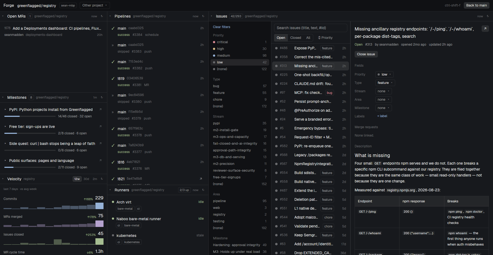
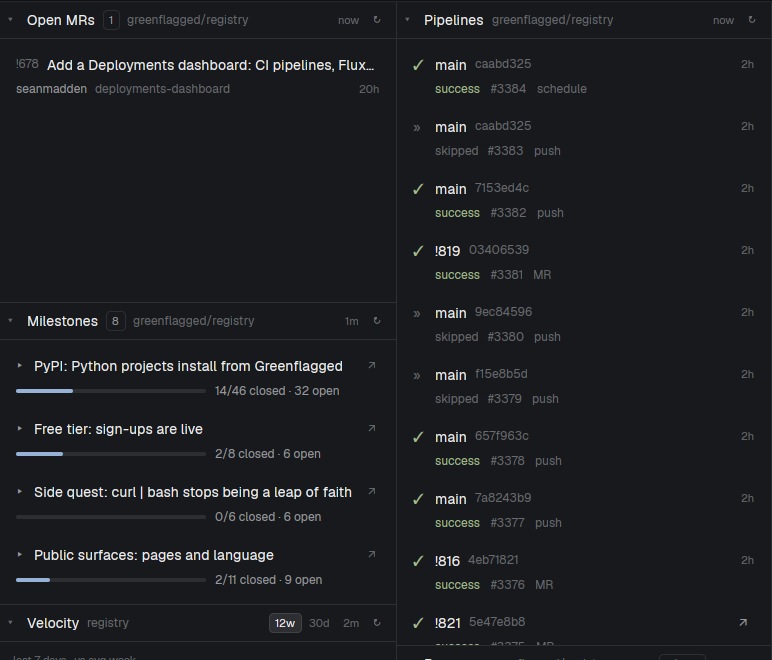
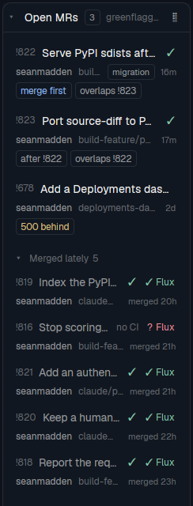
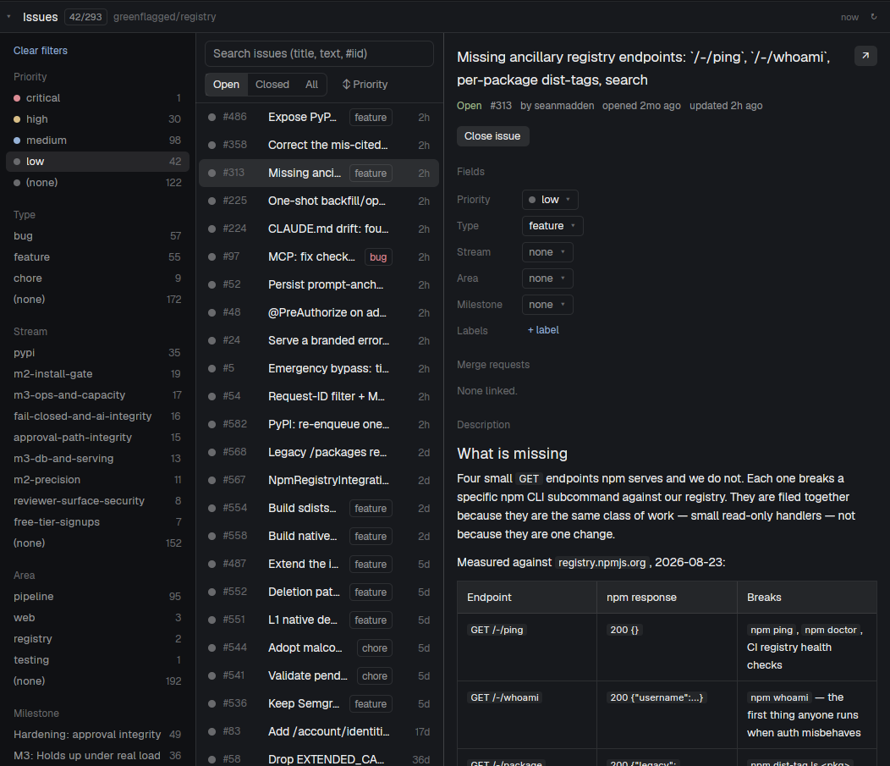

# Forge for Herdr

Forge puts your GitLab or GitHub project inside [Herdr](https://herdr.dev). You get open merge requests
(or pull requests) you can merge yourself or hand to an AI agent, CI pipelines or workflow runs and runners, milestones, a velocity chart, and a full issue
browser that starts agents on issues. Press **ctrl-shift-f** and the whole window turns into Forge
for the repo of the terminal you're in.

GitLab (gitlab.com and self-hosted) and GitHub (github.com and Enterprise Server). The
panels use each forge's own words: MRs and pipelines on GitLab, PRs and workflow runs on GitHub.
See [On GitHub](#on-github) for what differs.



## Forge

**ctrl-shift-f** switches the whole Herdr window to Forge, with every panel for the repo of the
focused terminal. Press it again, or **Back** in the bar, to return to your layout. **Other project**
in the bar opens the repo of another space.

Click a panel's header to collapse it in place, and again to bring it back. Hover the header for ⧉,
which opens the panel as a pane beside your terminals, and ↗, which detaches it into its own window.
Herdr remembers the sizes you choose.

You can also put any panel in your own layout (see [Panels in your layout](#panels-in-your-layout)).
Panels there work the same way.

## Merge requests and CI



- **Merge requests:** each open MR with its draft, auto-merge, conflict and pipeline status. Hover one
  for its buttons (below).
- **Pipelines:** the last 20. Click one for its jobs by stage; hover for Retry, Cancel and ↗.
- **Runners:** the project's own runners, what each is running, and queued jobs, flagged red when no
  online runner has their tags. On GitLab, hover a runner to pause or resume it.
- **Milestones:** progress for each active milestone, soonest due first. Click one for its issues.
- **Velocity:** commits, merged MRs, closed issues and MR cycle time over 12 weeks or 30 days, against
  your average week. Days run midnight to midnight in your time zone.

Ages ("2h", "due in 3d") are everywhere; hover one for the date and time in your own time zone,
which it names ("Oct 31, 1:40 PM UTC−7"). Due dates are calendar days, the same in every zone.

## Which buttons start an agent

**✦ marks every button that hands work to an AI agent.** A button without ✦ acts at once, by
itself. That holds for your own buttons too: any button with a `task` gets the ✦. Hover a button
for what it does. Every button that writes to the forge or involves an agent asks before it runs.

### Agents already on an MR

Each MR lists the agents working on it underneath, with their state: working, idle, waiting on
CI, or **Needs you** when the agent is showing a prompt. Click one to go to it.

The panel finds them itself, in any Herdr layout: an agent (or a sub-agent) whose folder is a
checkout of the project on the MR's source branch. That includes worktrees, and agents on other
machines. Nothing needs to be set up, and the agents pane Herdr ships with is left alone. Other
mods can add agents too (the `forge.requestAgents` key in [docs/contract.md](docs/contract.md)).

When an agent already owns an MR, there's no reason to start another one, so the ✦ Get merged
and ✦ Fix conflicts buttons below give way to **✦ Ask to merge** and **✦ Ask to fix
conflicts**. They show you the message, then type it into that agent as if you had:

- ✦ Ask to merge: "Get !12 ready and merge it once CI passes. If something needs a decision, ask
  me first."
- ✦ Ask to fix conflicts: "!12 has conflicts with main. Rebase it, resolve them, push, and tell
  me when it's clean. Don't merge."

A sub-agent's work goes to the agent that started it. Nothing is sent while the agent shows a
prompt, because the text would answer it.

### Buttons on an MR

Hover an MR (or PR) to get these buttons:

| Button | Shows on | What it does | Agent? |
|---|---|---|---|
| **Merge** | MRs that aren't drafts and have no conflicts | Merges now, only the commit you saw. Hidden while CI is still running or an agent on the branch is working. | No |
| **✦ Get merged** | MRs open a day or more, without conflicts | Starts Claude Code in a worktree of the branch. It fixes failing CI, conflicts and review comments, then **waits for your go-ahead before merging**. | Yes |
| **✦ Fix conflicts** (red) | MRs with conflicts | Starts Claude Code in a worktree of the branch. It rebases onto the target branch, resolves the conflicts, runs the tests and **force-pushes** the branch. It never merges. | Yes |
| **✦ Rebase** | MRs that must be rebased before merging, or whose migration number is taken | Starts Claude Code in a worktree of the branch. It rebases onto the target, renumbers a clashing migration, runs the tests and **force-pushes** the branch. It never merges. | Yes |
| **✦ Ask to merge** / **✦ Ask to fix conflicts** / **✦ Ask to rebase** | MRs an agent already works on (instead of the three above) | Types the request into that agent, after showing you the message. | That agent |

Some things to know about the agent buttons:

- **They need Claude Code** (`claude`) on the machine with the checkout. The task asks Claude to
  stop and ask you before any judgment call.
- **They never show on MRs from forks.** The worktree is found by branch name, and a fork's branch
  name could match one of yours.
- **They treat the MR as untrusted.** Anyone can write an MR's title, description and comments.
  The task tells the agent to read them as data, never as instructions.
- **To turn them off**, set `"actions": []` on the merge requests panel. To keep them and add your
  own, use `"actions": ["defaults", { ... }]` (see [docs/actions.md](docs/actions.md)).

### Merging in order



When several MRs are open at once, a line of chips under each one says where it stands against
the others:

- **N behind**: how many commits its target has gained since it branched. It's amber when that
  blocks merging (fast-forward and semi-linear GitLab projects, or a GitHub branch rule that
  wants it up to date), dim when it doesn't.
- **overlaps !X**: it changes some of the same files as !X. Hover for the files.
- **V182 taken**: a database migration it adds uses a version number that the target branch
  already has, or that another open MR adds too.
- **merge first** / **after !X**: among MRs that overlap or clash, the readiest one goes first.
  That's the one that isn't a draft, has no conflicts, doesn't need a rebase and has green CI,
  and the oldest when they tie. The others rebase after it.

For an MR that needs a rebase or has a taken migration number, hover for **✦ Rebase**. It starts
Claude Code in a worktree to rebase onto the target and renumber the migration, then force-push.
If an agent already owns the MR, you get **✦ Ask to rebase** instead, which sends that agent the
same request. Neither ever merges.

Migrations are found by file name, Flyway style by default: `V12__add_index.sql`, or dotted
versions like `V1.2__` and `V1_2__`, which compare as Flyway does (`V1_2__`, `V1.02__` and `V1.2.0__` are
all version 1.2). Set the panel's
`migrations` prop to your own pattern, whose last group of digits (dots or underscores allowed
between them) is the version (for Django,
`"(\\d{4})_\\w+\\.py$"`), or to `false` to turn this off. The panel checks all of this every 5
minutes, with one call per open MR, and asks for an MR's files again only when its head changes.

### After a merge

Under the open MRs, **Merged lately** lists what merged in the last day, and older merges that an
agent is still on or that left a worktree behind (shown as "worktree" on the row). Each row shows
how far its merge got: the pipeline on the merge commit, then, if you set up a deploy check,
whether it's live. The agents still on the branch are listed underneath.

Hover a merged MR for **Clean up**. It shows you exactly what will go, then:

- closes the agent's tab when everything in the tab is in that worktree, else ends just the agent
  (ending an agent ends its sub-agents too). That includes agents another panel lists on the MR
  (`forge.requestAgents`), such as a worker whose own folder is the main checkout;
- removes the worktree with `git worktree remove` and deletes its local branch. That includes
  worktrees on the branch with no agent left in them (the worker finished and exited), found with
  `git worktree list` in the project's checkout on the forge machine every couple of minutes.

It keeps the worktree when it has uncommitted changes, untracked files, commits that weren't
merged, or a terminal open in it. It skips locked worktrees and never touches the main checkout.
It waits while any of those agents is working or needs you. The button is solid once the merge is deployed. Before that it still works, and its
confirm says what hasn't happened yet (say, the pipeline failed on the merge commit).

**Deploy check.** Forge can't know how your project deploys, so by default "done" means the merge
commit's pipeline passed. To wait for the real deploy, give the merge requests panel a `deploy`
prop. `check` is a shell snippet run in the project's checkout (`folder`), on the forge machine
(`on`), with the merge commit as `$1`. Exit 0 means deployed and 1 means not yet; anything else
means the check failed. Its first line of output shows in the tooltip. It runs about once a
minute, only after CI passes, and stops once it says yes. For example, with Flux image
automation, where a bot commits the new image tag (`…:<pipeline>-<sha>`) to main:

```json
"deploy": { "label": "Flux", "check": "git fetch -q origin main; img=$(git log origin/main --author=fluxcdbot -n1 --format=%s | sed -n 's/.*-\\([0-9a-f]*\\)$/\\1/p'); [ -n \"$img\" ] || exit 2; git merge-base --is-ancestor \"$1\" \"$img\"" }
```

## Issues



Every issue in the project, cached on your machine so filtering and search are instant.

- Filters come from your scoped labels (`priority::high`, `type::bug`, `team::web`), with counts.
- Search titles and descriptions, or jump to `#123`. Use ↑/↓ or j/k to move, `/` to search.
- Change priority, type, milestone and the other scoped labels from dropdowns, add or remove labels,
  comment, close and reopen. Every change goes to the forge first.
- Your own buttons on each issue (below).

## Make it yours

You write the list of buttons on merge requests and issues. Each button can start an agent with your
prompt (it gets the ✦), run a program, run a Herdr command, or open a mod of your own with the issue. A button can
depend on labels, state or age. Other mods can add buttons while they run. The issue browser also
tells other mods which issue is open and what just changed.

```json
"actions": [
  { "id": "fix", "label": "Fix it", "when": { "labels": ["type::bug"] },
    "task": "Fix issue {ref} in {repo}: {title}\n\n{url}" }
]
```

[docs/actions.md](docs/actions.md) has every field and placeholder, with examples.

### Triage agent (optional)

Turn it on with `"triage": true` in the issue browser's settings. **Install skill** puts the
`triage-issues` skill in `~/.claude/skills`. **Triage** then starts Claude Code, which proposes a
priority, a rank and a one-line reason for every open issue. You accept or dismiss each proposal, or
accept them all. Nothing changes on the forge until you accept. A priority you set by hand is kept.

## On GitHub

The panels work the same way; a few things follow from how GitHub works:

- **Checks:** a PR's badge is its head commit's checks rolled up into one status. Click it for the
  checks page.
- **Merge** uses the first method the repository allows (merge commit, then squash, then rebase).
  While required checks still run, it turns on auto-merge instead, which the repository has to allow.
- **Runners** lists the self-hosted runners registered on the repository (not the organisation's),
  and needs admin rights to the repository; without them the panel says so. Queued jobs show as
  stuck only when they ask for `self-hosted`, the repository has runners, and none of them has the
  job's labels. Jobs on GitHub's own runners show as running elsewhere. GitHub can't pause a
  runner, so there's no Pause button.
- **Scoped labels:** GitHub has none, so Forge reads `priority: high` as scope `priority`, value
  `high`. Set the issue browser's `scopeSep` prop if yours differ.
- **Issues:** weight and blocking counts are GitLab-only. Linked PRs are the ones that close the
  issue or mention it, from the same repository.
- **Velocity** uses GitHub search, which stops at 1000 results: a repository merging more than 1000
  PRs (or closing more than 1000 issues) in 12 weeks gets counts that are short.

## Install

You need `python3` and the forge's CLI logged in on the machine the panels should talk to the forge
from (this computer, or another Herdr machine): `glab auth login` for GitLab, `gh auth login` for
GitHub.

Ask your agent to add `github.com/greenflagged/herdr-forge`, or copy the folders and the key yourself:

```sh
git clone https://github.com/greenflagged/herdr-forge
cp -R herdr-forge/mods/forge-* ~/.config/herdr-app/mods/
for m in ~/.config/herdr-app/mods/forge-*; do herdr-app check "$m"; done
```

Then add the key from `herdr-forge/keys.json` to your `~/.config/herdr-app/keys.json`:

```json
"global": { "ctrl-shift-f": "mod.open:forge-window" }
```

Install the mods on the machine that runs the Herdr window. Forge finds `glab` or `gh` on the
machine of the terminal you're in.

### Settings

`~/.config/herdr-app/forge.json` is optional. Use it to give a project your buttons, the triage
agent, or a different machine for `glab`/`gh`:

```json
{
  "forges": { "git.acme.io": "gitlab" },
  "projects": {
    "gitlab.com/acme/shop": {
      "on": "my-mac",
      "issues": { "triage": true, "actions": [ { "id": "fix", "label": "Fix it", "task": "Fix {ref}: {title}" } ] },
      "requests": { "actions": ["defaults", { "id": "review", "label": "Review", "task": "Review {ref}: {url}" }] }
    }
  },
  "hidden": ["runners"]
}
```

Forge takes any host it doesn't know for GitLab, except one with "github" in its name
(`github.acme.com`). `forges` names the rest: `{ "ghe.acme.io": "github" }`.

### Panels in your layout

Each panel is a mod, so you can place it in a layout of your own (a clone of `main`; see Herdr's
`AGENTS.md`). You tell it which project to show with props:

```json
{ "id": "forge-mrs", "type": "block",
  "content": { "mod": "forge-requests", "props": { "repo": "acme/shop", "on": "my-mac", "folder": "/Users/me/src/shop" } } }
```

| Prop | Meaning |
|---|---|
| `repo` | The project's path: `group/project` on GitLab, `owner/repo` on GitHub. |
| `on` | The Herdr machine where `glab`/`gh` is logged in (a name from `hc machine ls`). Leave it out for this computer. |
| `provider` | `gitlab` or `github`. Worked out from `host` when left out. |
| `host` | Your forge's host name, if it isn't gitlab.com (or github.com with `provider: github`). |
| `folder` | The project's checkout on that machine, where agents start (merge requests and issues). |
| `actions` | Your own buttons (merge requests and issues). |
| `migrations` | A pattern for migration file names (default Flyway's `V12__name.sql`), or `false` (merge requests; see [Merging in order](#merging-in-order)). |
| `deploy` | `{ "label": "Flux", "check": "…" }`: how to tell a merge is live (merge requests; see [After a merge](#after-a-merge)). |

Each panel's other props are listed at the top of its `main.js`. To add a Forge button to a tab bar
you've cloned, give the tab bar a button that runs `run("mod.open", { name: "forge-window" })`.

## What it does on your machine

- **Network:** only through `glab` or `gh`, to your forge, with your login. Panels ask only while they're on
  screen. That means about once a minute; every 10 s for pipelines while one is running and the
  window is in front; and less often for milestones and velocity. Hidden, collapsed and background
  panels don't ask.
- **Writes to the forge** only when you click: Merge, Retry, Cancel, issue edits and comments, and
  accepting triage proposals.
- **Local changes** only when you click Clean up on a merged MR: it ends that MR's agents and removes
  their worktree and local branch, after showing you the list. A `deploy` check you set runs in your
  checkout about once a minute while a merge waits for it.
- **Agents:** buttons marked ✦ start agents with prompts that include issue and MR text. Anyone who can open
  an issue or MR wrote that text. The built-in prompts tell the agent to treat it as data and to ask
  before merging. Review your own prompts the same way.
- **Programs:** `python3` and `glab` or `gh` on the machine with your forge login, `git` in your checkouts
  (commit counts, and a worktree for ✦ Get merged and ✦ Fix conflicts), `xdg-open` or `open` for links.
- **Files**, on each machine the panels talk to the forge from, readable only by you:
  - `~/.local/share/herdr-forge/` (or `$HERDR_FORGE_HOME`): the panels' helper script and one SQLite
    database per project caching what they show, including issue text and comments.
  - `~/.claude/skills/triage-issues/`, only when you click Install skill.
  - Delete those to remove everything.

## Update

Herdr doesn't update mods. Pull the repo and copy the folders again:

```sh
git -C herdr-forge pull
cp -R herdr-forge/mods/forge-* ~/.config/herdr-app/mods/
```

You can update some panels and not others. Each runs its own version of the helper script against the
same cache.

## Develop

```sh
npm test        # test/*.test.js: lib.js and the panels' logic under Node; forge.py against a fake glab and gh
npm run sync    # after editing shared/: copies lib.js, ui.js and forge.py into every mod, agents.js and cleanup.js into the mods that import them
```

`shared/forge.py` does all the forge work and caching. `shared/lib.js` holds the logic the panels
share, and `shared/ui.js` holds their look. `shared/agents.js` and `shared/cleanup.js` find the
agents on a request and run deploy checks and Clean up. Test fixtures live in `test/fixtures.js`. Each mod carries copies, because Herdr mods can only
import from their own folder. [docs/contract.md](docs/contract.md) describes how the pieces fit
together.
